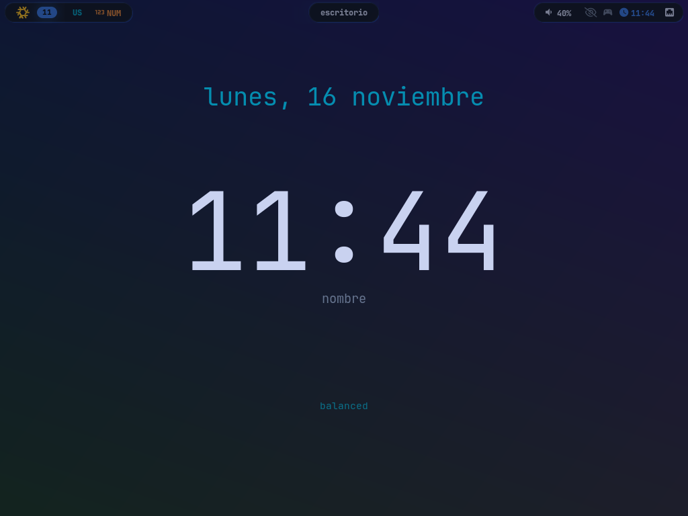
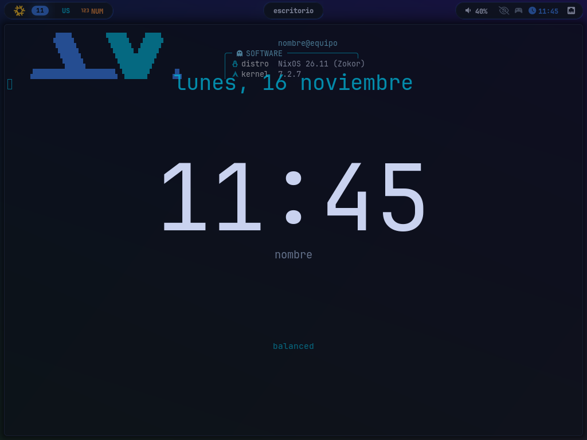
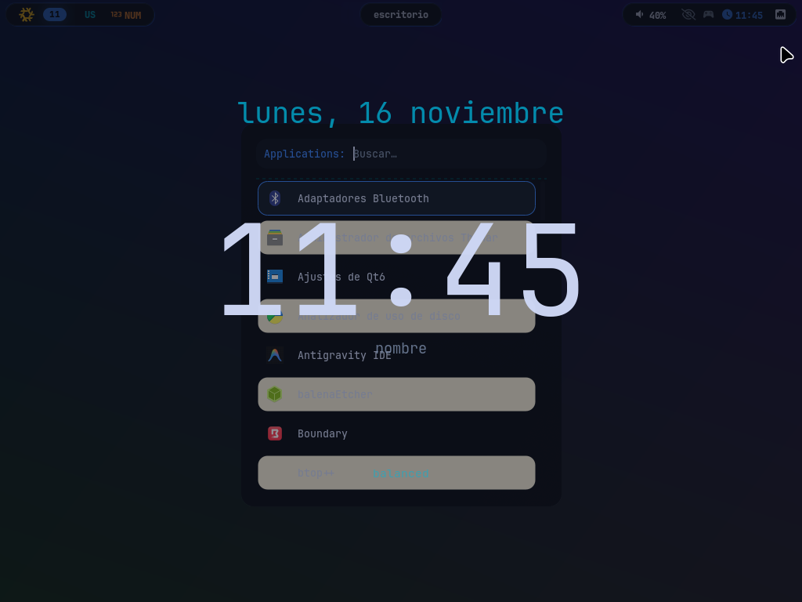

# NixOS Hyprland Starter

Una base personalizable de NixOS con Hyprland, Home Manager y dotfiles incluidos.
Preparada a partir de mi escritorio y probada mediante una instalación
manual en VM. Cada persona mantiene su configuración y hardware en su propia copia.

## Empezar en una VM

Probá primero con una ISO oficial y un disco virtual nuevo de 40 GiB. La guía
recoge una instalación manual con 2 CPU, 4 GiB de RAM y swap temporal.

**Atención: el particionado borra el disco elegido.** No ejecutar esos comandos
en el anfitrión ni sobre un disco con datos que quieras conservar.

## Instalar

Seguir la **[guía de instalación completa](docs/INSTALACION.md)** desde la ISO:
UEFI, EFI + Btrfs sin cifrado, subvolúmenes, usuario, instalación, SSH y escritorio.
El particionado de la guía reemplaza un disco completo; no es una receta de dual boot.

```bash
git clone https://github.com/cRolandoJr/nixos-hyprland-starter.git
```

Antes de construir, cambiar `personal.nix`, generar el hardware del equipo destino
y resolver los bloqueos de `hosts/equipo/hardware.nix` y `disk.nix` siguiendo la guía.
No ejecutar un rebuild de la plantilla sin adaptar. La ruta definitiva de la copia
instalada es `~/projects/nix-config`, utilizada por los enlaces de Home Manager.

## Qué incluye

- Hyprland, Waybar, Eww, mako, rofi y configuración de terminal/editor.
- Ryogami para elegir tus propios fondos en `dotfiles/Wallpapers`.
- Gaming: Steam y herramientas de rendimiento.
- Virtualización: libvirt, QEMU/KVM, virt-manager y Podman.
- SSH desactivado por defecto; activación opcional con claves públicas.
- Sudo solicita contraseña, también para rebuild y limpieza de generaciones.

La selección de módulos compartidos vive en `modules/workstation.nix`. Los datos
de usuario y hostname están en `personal.nix`; la configuración de Home Manager,
en `home/user.nix`. Al cambiar hostname, renombrar también la carpeta de host.

## Vista previa

Capturas reales tomadas de la VM instalada (con fondo propio generado para esta
vista previa):







## Estado de verificación

La instalación descrita a continuación es la prueba previa a los cambios de
SSH, sudo y fondos. Esta revisión todavía requiere repetir el arranque en VM.

Instalación guiada comprobada en VM x86_64 con UEFI, QXL sin OpenGL, 4 GiB de RAM
más swap temporal durante la instalación y disco virtual de 40 GiB. Arrancaron
Hyprland y el escritorio; se verificaron SSH, selector de fondos y ausencia de
unidades fallidas en la comprobación realizada. No se validaron gaming, virtualización
anidada ni GPU, Wi-Fi o suspensión de las laptops destinatarias.

`starter-vm` es una definición experimental de VM automática, ajena al procedimiento
manual probado. Para instalar, usar el output definido por el hostname personal.

La guía documenta también los fallos observados y cómo se diagnosticaron. La
[procedencia](docs/origen.md) conserva el historial de preparación.

## Personalización y actualizaciones

Crear un fork si se desean mantener cambios propios en GitHub. Mantener `flake.lock`
para reproducir las dependencias y revisar sus cambios antes de actualizar.
No subir UUID ni claves privadas de otras personas. Las generaciones NixOS no
revierten los dotfiles editables fuera del store: respaldarlos y versionarlos.

## Perfil mínimo: evaluación

Gaming y virtualización están separados en `modules/workstation.nix`, pero
`home/user.nix` sigue incluyendo aplicaciones y herramientas del escritorio.
Quitar dos imports no equivale a un perfil mínimo probado. Por ahora se conserva
un solo perfil; una variante reducida tendría sentido cuando haya un usuario
concreto y una selección de paquetes que se pueda instalar y verificar en VM.
No es un requisito para usar el starter.

## Atribuciones y recursos

Las aportaciones propias del starter (configuración NixOS, scripts de soporte y
documentación) se distribuyen bajo la licencia [MIT](LICENSE). Los componentes
incorporados de terceros conservan sus respectivas licencias y avisos,
detallados en [licencias y atribuciones](docs/LICENCIAS.md) (incluyendo
`pkgs/ryogami/wall-ui/LICENSE` bajo MIT y `pkgs/ryogami/daemon` bajo GPL-3.0).

Los 86 wallpapers de terceros se retiraron tanto del árbol actual como del
historial Git para reducir el peso del repositorio y evitar redistribuir
imágenes sin permisos verificados. Añadí tus propios fondos siguiendo las
instrucciones de [Wallpapers](dotfiles/Wallpapers/README.md).
